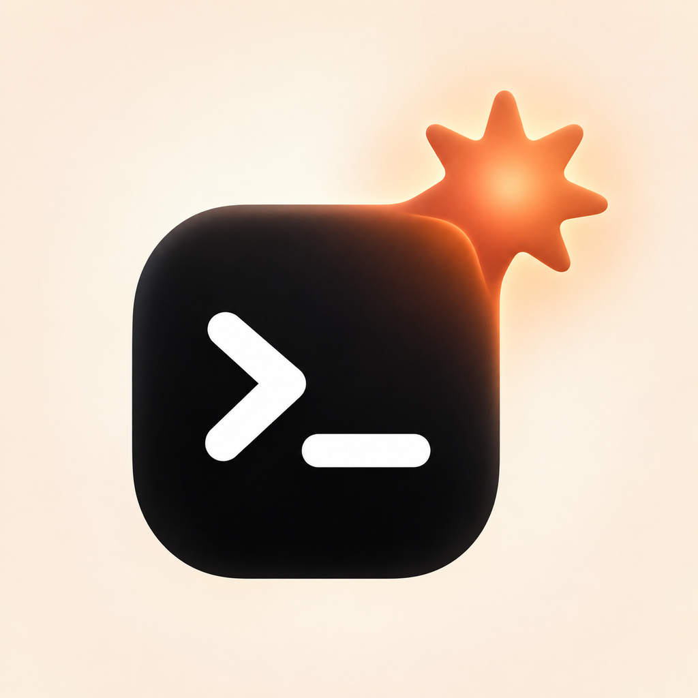

<p align="center">
  
</p>

# codex-harness

A Claude Code plugin that lets Claude hand writing jobs to **OpenAI Codex**. You keep working with Claude as usual: building your game, app, whatever. When something needs a written asset (a bestiary, quest list, lore bible, dialogue, level spec, docs), Claude briefs Codex, Codex writes it, and the result lands in your project as a **markdown file**. Claude then reads it and keeps going.

```
You ──► Claude Code ──(brief + reference files)──► codex exec (read-only)
                ▲                                        │
                └──── reads assets/bestiary.md ◄── script saves Codex's answer
```

## Quick start

**1. Install the plugin.** At the Claude Code prompt:

```
/plugin install codex-harness --marketplace Makogai/claude-codex-harness
```

Answer `y` to add the marketplace, then pick a scope (user scope = every project). From a normal shell, the same thing is `claude plugin install codex-harness --marketplace Makogai/claude-codex-harness`.

**2. Set up Codex.** Start a new Claude Code session. If Codex is missing or logged out, a notice says so at the top. Then run:

```
/codex-harness:setup
```

Claude checks everything, installs the Codex CLI for you (after asking), and tells you when to type `! codex login` so you can sign in in the browser. It can also run a quick test at the end.

**3. Use it.** Ask Claude to have Codex write something (see [Use](#use)).

## Requirements

- [Claude Code](https://claude.com/claude-code)
- [Codex CLI](https://github.com/openai/codex), installed and logged in. `/codex-harness:setup` handles both. To do it by hand:
  ```
  npm i -g @openai/codex      # or on macOS: brew install --cask codex
  codex login
  ```
  Codex needs a ChatGPT plan or an OpenAI API key. Each person uses their own account. If you use the `OPENAI_API_KEY` or `CODEX_API_KEY` environment variable instead of logging in, the startup check accepts that.
- `bash`: built into macOS and Linux. On Windows, install [Git for Windows](https://git-scm.com/download/win), which includes Git Bash.

### The startup check

The plugin adds a small check that runs when a Claude Code session starts (`hooks/check-codex.sh`). It runs only `command -v codex` and `codex login status`, makes no network calls, and stays silent when everything is ready. If something's missing, you see a one-line notice, and Claude knows to offer setup before trying to use Codex.

## Use

Just ask in plain language:

> Build the enemy system. Have Codex write the bestiary first: 12 enemies, stats within the ranges in docs/design.md.

> Get Codex to draft the dialogue for the blacksmith, the innkeeper and the ferryman.

Or call it directly:

```
/codex-harness:asset 5 light-restoring items for the flooded mine level
```

Claude writes the brief, chooses a path (default `assets/<name>.md`), passes along the files Codex needs, and runs Codex. Several assets can run in parallel. Expect roughly 15 seconds to a few minutes per asset.

### Consistent style across assets

Add a `CODEX_STYLE.md` to your project root. It's included in every brief automatically:

```markdown
# Style
- Setting: flooded mining town, 1890s. Folk-horror, melancholy, a little hopeful. No gore.
- Names: Anglo-Cornish mining slang. No modern words.
- Entries use a stats table, then **Behaviour:** and **Lore:** lines.
```

## How it works

The skill tells Claude when and how to delegate. The script `skills/asset/scripts/codex-gen.sh` does the actual call:

```
codex-gen.sh <out.md> [--ref <file>]... [--overwrite] [--model <m>] [--effort <level>] <<'BRIEF'
...
BRIEF
```

- **Codex runs read-only** (`codex exec --sandbox read-only`). It never edits your project. The script saves Codex's final answer to `<out.md>`, so every call produces exactly one markdown file.
- **Reference files are pasted into the prompt** (`--ref`) instead of Codex reading them itself. This gives the same results on every OS. Without it, Codex on Windows sometimes couldn't run its file-reading commands and guessed the contents instead.
- **Guard rails:** output must be a `.md` path inside the project, no `..`, existing files are never replaced without `--overwrite`, and a recursion guard stops a Codex run from starting another harness call.

| Env var | Default | Effect |
|---|---|---|
| `CODEX_HARNESS_MODEL` | your Codex config | model for Codex |
| `CODEX_HARNESS_EFFORT` | your Codex config | reasoning effort (`low` / `medium` / `high`) |
| `CODEX_HARNESS_TIMEOUT` | `600` | seconds before a run is stopped (needs GNU `timeout`) |
| `CODEX_HARNESS_MAX_REF_KB` | `400` | size limit for all `--ref` files combined |
| `CODEX_HARNESS_LOG` | unset | save Codex's full output to this path (for debugging) |

### Fewer permission prompts

Claude Code asks before running the script. Picking "don't ask again" when it does is the easy fix. A rule like `Bash(bash:*)` in your settings also removes the prompt, but it allows *any* `bash …` command, so only add it if you're fine with that.

## Troubleshooting

- **Anything setup-related**: run `/codex-harness:setup` first.
- **`codex CLI not found` right after installing**: npm's global folder isn't on your PATH yet. Restart the terminal and Claude Code, then check that `codex --version` works.
- **Auth or usage-limit errors**: run `codex login` (inside Claude Code: `! codex login`).
- **Generic or invented content**: pass the files that matter with `--ref` (or ask Claude to), and add a `CODEX_STYLE.md`.
- **See what Codex did**: set `CODEX_HARNESS_LOG=codex.log` and run again.

## Developing

```
claude --plugin-dir /path/to/claude-codex-harness
claude plugin validate /path/to/claude-codex-harness
```

## License

MIT
