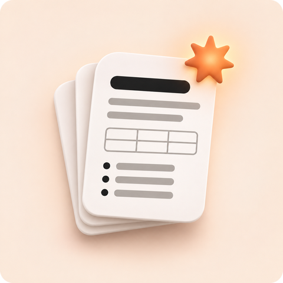
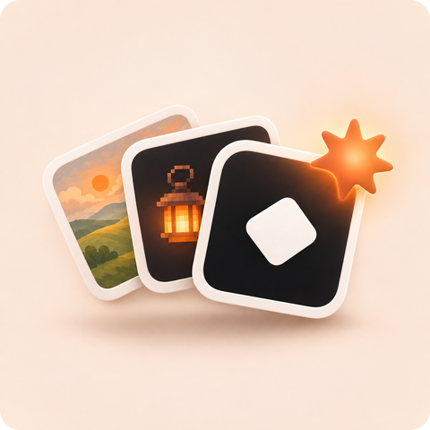
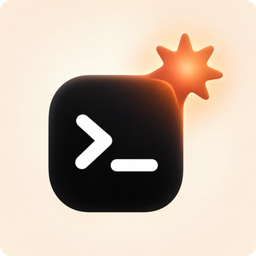
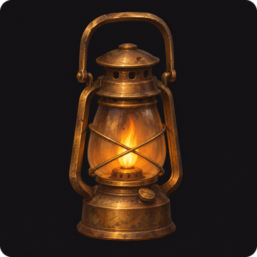

<p align="center">
  
</p>

<h1 align="center">codex-harness</h1>

<p align="center">
  <b>Claude Code briefs. Codex makes the asset. It lands in your project.</b>
</p>

<p align="center">
  
  
  
  <a href="LICENSE"></a>
</p>

A Claude Code plugin that lets Claude hand work to **OpenAI Codex**. You keep working with Claude as usual: building your game, app, whatever. When something needs an asset, Claude briefs Codex, Codex makes it, and the result lands **in your project folder**. Claude then checks it and keeps going.

<table>
  <tr>
    <td align="center" width="50%">
      <br>
      <b>Written assets → <code>.md</code></b><br>
      <sub>bestiary, quest list, lore bible, dialogue, level spec, docs</sub>
    </td>
    <td align="center" width="50%">
      <br>
      <b>Visual assets → <code>.png</code></b><br>
      <sub>icons, sprites, concept art, backgrounds (Codex image generation)</sub>
    </td>
  </tr>
</table>

<p align="center">
  
</p>

<p align="center">
  <sub><b>Claude</b> writes the brief and picks the reference files → <b>Codex</b> makes the asset (read-only, never touches your code) → the file is saved <b>in your project</b>, and Claude checks it and uses it.</sub>
</p>

## Quick start

**1. Install the plugin.** At the Claude Code prompt:

```
/plugin install codex-harness --marketplace Makogai/claude-codex-harness
```

Answer `y` to add the marketplace, then pick a scope (user scope = every project). From a normal shell, the same thing is `claude plugin install codex-harness --marketplace Makogai/claude-codex-harness`.

**2. Set up Codex.** Start a new Claude Code session. If Codex is missing or logged out, a notice says so at the top. Then run:

```
/codex-harness:setup
```

Claude checks everything, installs the Codex CLI for you (after asking), and tells you when to type `! codex login` so you can sign in in the browser. It can also run a quick test at the end.

**3. Use it.** Ask Claude to have Codex write or draw something (see [Use](#use)).

## Requirements

- [Claude Code](https://claude.com/claude-code)
- [Codex CLI](https://github.com/openai/codex), installed and logged in. `/codex-harness:setup` handles both. To do it by hand:
  ```
  npm i -g @openai/codex      # or on macOS: brew install --cask codex
  codex login
  ```
  Codex needs a ChatGPT plan or an OpenAI API key. Each person uses their own account. **Images need the ChatGPT login.** If you use the `OPENAI_API_KEY` or `CODEX_API_KEY` environment variable instead of logging in, the startup check accepts that, but you'll only get markdown.
- `bash`: built into macOS and Linux. On Windows, install [Git for Windows](https://git-scm.com/download/win), which includes Git Bash.

### The startup check

The plugin adds a small check that runs when a Claude Code session starts (`hooks/check-codex.sh`). It runs only `command -v codex` and `codex login status`, makes no network calls, and stays silent when everything is ready. If something's missing, you see a one-line notice, and Claude knows to offer setup before trying to use Codex.

## Use

Just ask in plain language:

> Build the enemy system. Have Codex write the bestiary first: 12 enemies, stats within the ranges in docs/design.md.

> Get Codex to draft the dialogue for the blacksmith, the innkeeper and the ferryman.

> Have Codex draw a sprite for each item in assets/items.md, painterly style, dark background.

> Get Codex to make an app icon for this project, then resize it to 1024x1024.

Or call it directly:

```
/codex-harness:asset 5 light-restoring items for the flooded mine level
/codex-harness:asset a pixel-art lantern sprite
```

Claude writes the brief, chooses a path (default `assets/<name>.md` or `assets/<name>.png`), passes along the files Codex needs, and runs Codex. Several assets can run in parallel. Expect roughly 10 seconds to a few minutes per document, and about a minute per image.

Image generation picks its own resolution (often about 1254 px square). If you need an exact size or format, just ask Claude to convert it afterwards.

### Made with it

All the art in this README was made by Codex image generation, most of it through this plugin. A few examples of what you can ask for:

<table>
  <tr>
    <td align="center" width="25%"><br><sub>an icon for this plugin, Codex + Claude</sub></td>
    <td align="center" width="25%"><br><sub>a painterly brass mining lantern item</sub></td>
    <td align="center" width="25%"><br><sub>a pixel-art slime enemy</sub></td>
    <td align="center" width="25%"><br><sub>concept art: a flooded 1890s mining town at dusk</sub></td>
  </tr>
</table>

The banner, the two cards and the flow strip were made in one go: four image requests run in parallel, each with the plugin icon passed as `--ref` and a shared `CODEX_STYLE.md`, so they match.

### Consistent style across assets

Add a `CODEX_STYLE.md` to your project root. It's included in every brief automatically, for documents and images:

```markdown
# Style
- Setting: flooded mining town, 1890s. Folk-horror, melancholy, a little hopeful. No gore.
- Names: Anglo-Cornish mining slang. No modern words.
- Entries use a stats table, then **Behaviour:** and **Lore:** lines.
- Art: painterly 2D, warm lantern light against cold blue-black shadows, no outlines.
```

## How it works

The skill tells Claude when and how to delegate. The script `skills/asset/scripts/codex-gen.sh` does the actual call:

```
codex-gen.sh <out.md|out.png> [--ref <file>]... [--overwrite] [--model <m>] [--effort <level>] <<'BRIEF'
...
BRIEF
```

- **One file per call, always in your project.** For `.md`, the script saves Codex's final answer to that path. For `.png`, Codex uses its built-in image generation, and the script moves the image out of `~/.codex/generated_images/` into your project at that path. Nothing is left behind there.
- **Codex runs read-only** (`codex exec --sandbox read-only`). It never edits your project. The script writes the result.
- **`--ref` gives Codex context.** Text files are pasted into the prompt instead of Codex reading them itself, which gives the same results on every OS. (Without this, Codex on Windows sometimes couldn't run its file-reading commands and guessed the contents.) Images (`.png .jpg .jpeg .webp .gif`) are attached so Codex can see them, for "make a variant of this" or "match this style".
- **Guard rails:** output must be a `.md` or `.png` path inside the project, no `..`, existing files are never replaced without `--overwrite`, and a recursion guard stops a Codex run from starting another harness call.

| Env var | Default | Effect |
|---|---|---|
| `CODEX_HARNESS_MODEL` | your Codex config | model for Codex |
| `CODEX_HARNESS_EFFORT` | your Codex config | reasoning effort (`low` / `medium` / `high`) |
| `CODEX_HARNESS_TIMEOUT` | `600` | seconds before a run is stopped (needs GNU `timeout`) |
| `CODEX_HARNESS_MAX_REF_KB` | `400` | size limit for all text `--ref` files combined |
| `CODEX_HARNESS_LOG` | unset | save Codex's full output to this path (for debugging) |

### Fewer permission prompts

Claude Code asks before running the script. Picking "don't ask again" when it does is the easy fix. A rule like `Bash(bash:*)` in your settings also removes the prompt, but it allows *any* `bash …` command, so only add it if you're fine with that.

## Troubleshooting

- **Anything setup-related**: run `/codex-harness:setup` first.
- **`codex CLI not found` right after installing**: npm's global folder isn't on your PATH yet. Restart the terminal and Claude Code, then check that `codex --version` works.
- **`image generation is not available`**: log in with ChatGPT (`codex login`), not just an API key, and update Codex (`codex update`).
- **Auth or usage-limit errors**: run `codex login` (inside Claude Code: `! codex login`).
- **Generic or invented content**: pass the files that matter with `--ref` (or ask Claude to), and add a `CODEX_STYLE.md`.
- **See what Codex did**: set `CODEX_HARNESS_LOG=codex.log` and run again.

## Developing

```
claude --plugin-dir /path/to/claude-codex-harness
claude plugin validate /path/to/claude-codex-harness
```

## License

MIT
